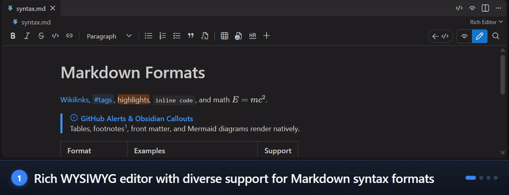

# Tandem Markdown

A WYSIWYG markdown editor for VS Code with support for a wide range of markdown syntax styles. You can keep a note open while an AI agent works on the same file, or while someone else's changes come in through a sync tool, a shared folder or git.

When the file changes, the change appears in front of you, and your unsaved typing stays where it is. Where you and the other program both changed the same words, your words are kept unless you choose otherwise, and the other program's words are written into a conflict file beside the note, which tells your agent what happened and what to do. So that your agent knows to look for that file, Tandem Markdown offers to add a few lines to `AGENTS.md`, and a rule file for Claude Code. A change from a git pull or checkout is merged the same way, but no conflict file is written for it: what can't be merged goes to a backup, and a message lets you compare it with your note.

Tandem Markdown natively draws rich content from a wide range of markdown sources: Obsidian's wikilinks and callouts, GitHub's tables, alerts, math and Mermaid diagrams, Pandoc's and MkDocs' boxes. Anything it doesn't know is shown as plain markdown, exactly as it is in the file.



Needs VS Code 1.120 or later, on the desktop. This preview release is built for Windows, macOS and Linux, but has been only minimally tested on macOS and Linux.

## Getting started

1. Install Tandem Markdown from the Visual Studio Code Marketplace, or run `code --install-extension fortwhimsy.tandem-markdown`.
2. Open a markdown file. It opens in Source.
3. Press `Alt+M` (`Ctrl+Cmd+M` on a Mac) to switch to the Rich editor, again for the Rich view, and again to go back to Source.
4. To open markdown files in the Rich editor every time, run "Tandem Markdown: Use Tandem Markdown by Default" from the Command Palette. It says what it will change in your settings before it changes anything, and "Tandem Markdown: Use Source by Default" changes it back.
5. If an agent edits your notes, give it Tandem Markdown's instructions: run "Tandem Markdown: Add Agent Instructions", or press "Update AGENTS.md" when Tandem Markdown offers them.

## What you get

- **Clean git diffs with zero reformatting.** Tandem Markdown holds your file's exact text and draws over it, so only the characters you edit change on disk. Opening a note, switching views, and closing it write nothing, and existing line endings and formatting stay intact ([What it promises](#what-it-promises)).
- **Three views in one tab.** [Source, Rich editor, and read-only Rich view](GUIDE.md#the-three-views) share one document, one cursor, and one undo history. Press `Alt+M` (`Ctrl+Cmd+M` on a Mac), click the title-bar buttons, or use the toolbar's eye/pencil toggle and back-to-code pill. Hold `Alt` while clicking a view button to open any view beside another with synchronized scrolling.
- **Broad native syntax from the tools you already use.** [Draws GitHub, Obsidian, Foam, Docusaurus, MkDocs, VitePress, Quarto, and Pandoc syntax natively](SYNTAX.md): YAML/TOML front matter tables, callouts and admonitions, `[[wikilinks]]` with autocomplete and hover note previews, live embedded notes (`![[Note]]`), `#tags`, colored `==highlights==`, footnotes with hover previews, auto-updating `[TOC]`, `<details>` collapsible HTML blocks, and syntax-highlighted code blocks with a one-click Copy button. Everything beyond CommonMark and GitHub defaults has its own setting, nothing inserted writes HTML, and anything unrecognized stays editable as plain markdown.
- **Built-in Mermaid diagrams and KaTeX math.** Render [Mermaid diagrams](GUIDE.md#a-diagram-opened-large) in your VS Code theme with full-tab pan and zoom, and edit math or diagram source in place with the live rendered preview visible underneath. Supports `$...$`, `$$...$$`, and chat-style LaTeX delimiters (`\(...\)` and `\[...\]`) pasted straight from AI assistants.
- **Fast editing, `/` insert menu, and real tables.** [Type `/` or click Insert](GUIDE.md#the-insert-menu) for a menu of every supported block and format (which stays out of the way for paths like `/usr/bin`). Click directly into table cells to edit in place with `Tab`/`Enter` navigation and row/column controls, without rewriting untouched rows in git diffs. Built directly on CodeMirror for smooth responsiveness on large markdown files.
- **Screenshot paste, image drop, and rich copy/paste.** [Paste a screenshot or drag an image onto a note](GUIDE.md#links-wikilinks-and-pictures) to save and link it automatically (respecting `markdown.copyFiles.destination`). Paste formatted text from web pages and documents as clean markdown, paste cells from spreadsheets straight into markdown tables, and copy out rich formatted text.
- **Heading folding, outline reorder, and remembered place.** Hover any heading to fold or unfold its section (`Ctrl+K Ctrl+L`), drag headings in the [Explorer outline](GUIDE.md#scroll-sync-the-outline-and-the-word-count) to reorder entire sections, track word count in the status bar, and [reopen every note where you left it](GUIDE.md#your-place-in-each-note) across restarts and file moves.
- **Native VS Code Git and editor tools inside WYSIWYG.** Keep [spell-check and lint underlines](GUIDE.md#vs-codes-own-tools-in-the-rich-editor-and-the-rich-view) with hover quick fixes (`Ctrl+.`), broken-link warnings, `F2` rename across links and headings, interactive git gutter change marks (click to peek committed lines or revert a hunk), inline [git merge-conflict buttons](GUIDE.md#gits-conflict-markers) (accept either side or both), and native VS Code git diff views even when Tandem Markdown is your default editor.
- **Built for AI agents and external tools.** Live 3-way merging over unsaved typing, one-click [agent setup](WORKING_WITH_AGENTS.md#setting-up-your-agent) (`AGENTS.md` and `.claude/rules/tandem-markdown.md`), "Copy Relative Path with Line Numbers" (`notes/Field notes.md:12-18`) for pasting into any chat, and a "Review in Source" button when Copilot has pending edits ([Copilot's review](WORKING_WITH_AGENTS.md#copilots-review-and-copy-relative-path-with-line-numbers)).
- **100% local, zero telemetry, works offline.** No accounts, no cloud sync, and no background network calls. It only loads remote `https:` media when a note links to it, and turning off `tandemMarkdown.images.allowRemote` keeps it completely offline.

## When an agent or someone else changes a note you have open

- Most changes merge with no message, even over unsaved typing, and in the Rich editor and the Rich view each line that changed is outlined until you have seen it, and the outline then fades after a few seconds.
- A note with nothing unsaved takes the new file as it is, keeping a quiet backup of the previous text before replacing it. If the file on disk stays cut short after a retry, Tandem Markdown writes a part in the conflict file and marks the spot in the Problems list.
- Where you both changed the same words, your words are kept at the clash (and non-overlapping edits merge), and a short pop-up says so:

  > Both you and another program edited Field notes.md; your words were kept at the clash and the rest merged.

  Its buttons are "See Diff" (which opens the other version beside your note) and "Dismiss". In the diff tab's title bar, "Use Change from Disk" applies the disk version at the clash (or "Replace My View" when the whole file could not be merged safely). Choosing either leaves a short strip at the top of the note's rich tab with "Undo", "See Diff", and "Dismiss".
- The conflict file, `Field notes.md.conflict`, tells your agent what happened, quotes the passages or versions involved, and tells it what to do. Then:
  1. If you want any of the other program's words in your note yourself, use "See Diff" and copy them or press "Use Change from Disk".
  2. Save the note. Saving writes your note over the file, so that your agent, which reads the note's file, finds your words there. Nothing is lost: the other program's version stays in its backup and in the conflict file.
  3. Give your agent the sentence that "Tandem Markdown: Copy Prompt for Agent" copies. Your agent reads the conflict file and finishes its change.

  The status bar counts open changes waiting for your agent in conflict files ("Tandem: 1 change") and shows a separate badge ("1 message for you") whenever an undo or recovery strip is waiting on a tab ("Tandem Markdown: Go to Waiting Message" jumps straight to it).
- Whenever Tandem Markdown sets aside or replaces a text, a copy goes to a backup first, in VS Code's own storage for extensions, not in your workspace ("Tandem Markdown: Open Backup Folder" opens it). A backup is kept for up to 30 days. "Tandem Markdown: Compare with Backup" lists a note's backups, with "Copy path" to hand one to an agent.
- The first time it writes a conflict file in a workspace, Tandem Markdown offers to add instructions for your agent:

  > Update AGENTS.md so your agent knows how to work with Tandem Markdown?

  Its buttons are "Update AGENTS.md" (which updates `AGENTS.md` and writes `.claude/rules/tandem-markdown.md`), "Copy instructions", and "Don't ask again".

**A conflict file can quote words you have typed and not saved.** It sits beside the note, so it syncs with the folder, and `git add -A` commits it. To keep conflict files out of git, add these lines to `.gitignore`, one for each kind of note the Rich editor and the Rich view open:

```gitignore
*.md.conflict
*.markdown.conflict
*.txt.conflict
```

Every message and its buttons, the conflict file and the backups are in [When an agent or another program changes your note](WORKING_WITH_AGENTS.md).

## What it promises

In these promises, your note is the text you work on in VS Code, with any typing you haven't saved, and the file is what is saved on disk. A tab shows your note in one of the three views.

- **Only what you edit changes in the file, with two exceptions.** VS Code itself gives a file with mixed Windows and Unix line endings one kind when it saves, and the setting that lines up a table's columns, off unless you turn it on, rewrites the whole table after each edit. Opening a note, switching views and closing it write nothing.
- **What you type lands where you typed it, or you are told it didn't, with one exception.** If another extension closes a tab, or you close it with a tap on a touchscreen, while the note has nothing else unsaved, the word you typed in the half second before can be lost, and you aren't told. A tab in the Rich editor or the Rich view holds its own copy of your note and keeps it in step with VS Code. If the two ever fall out of step, through a fault or because VS Code stopped answering the tab, the tab takes your note from VS Code again and tells you what you typed that was lost.
- **Another program's change goes into your note, or is kept in a backup or the conflict file and you are told, except in a few rare cases.** Two of them: if you move a line and another program deletes it before you save, the line stays where you put it, and that program's deletion is lost; and a change another program makes at the very moment VS Code saves can be lost. [Can you lose anything?](WORKING_WITH_AGENTS.md#can-you-lose-anything) lists each known case, with whether a copy is kept and whether you are told.
- **Markdown it doesn't support is shown as it is in the file,** and you can still edit it. The syntax reference lists it under [Shown as typed](SYNTAX.md#shown-as-typed). One piece of markdown can be shown wrongly: strikethrough written with one tilde straight after a word, such as `plan~was~`, is shown as subscript ([Drawn wrongly](SYNTAX.md#drawn-wrongly)).

If a tab ever seems to show something other than your note, "Tandem Markdown: Verify File" compares what the tab shows against your note and the file on disk. If you ever need to report a problem, "Tandem Markdown: Copy Diagnostics" copies your environment, settings, and redacted log entries with no note text.

## Before you install

- It doesn't run in VS Code for the Web (vscode.dev, github.dev).
- It isn't live co-editing as in Google Docs. A colleague's changes arrive when their copy of the file reaches yours, through git, a sync tool or a shared folder, not as they type.
- It goes online only to show pictures from https addresses in your notes and, once you turn on `tandemMarkdown.syntax.media`, to play video and sound from them. Turn off `tandemMarkdown.images.allowRemote`, and it doesn't go online at all.
- As soon as it is installed, it turns off VS Code's question before saving over a markdown file that changed on disk, since it has already merged that file into your note. This holds in Source, VS Code's own text editor, too. It is a default the extension adds, not a change to your settings, and [VS Code's save question](WORKING_WITH_AGENTS.md#vs-codes-save-question) says how to bring the question back.
- If you make it your default editor for markdown, a search result or a link to a line opens the note where you last left it, not at that line, because VS Code doesn't yet tell an extension's editor which line was asked for.
- It has no export and no spell checker of its own. A spell-check extension's underlines show in the Rich editor and the Rich view, Tandem Markdown's two WYSIWYG views.
- Uninstalling it brings VS Code's save question back, but leaves the settings that "Use Tandem Markdown by Default" wrote, so run "Use Source by Default" before you uninstall.

## More

- [Using Tandem Markdown](GUIDE.md): the views, writing, tables, paste, diagrams, your place in each note, the settings and the limits.
- [When an agent or another program changes your note](WORKING_WITH_AGENTS.md): setting up your agent, what to do about a message or a conflict file, and whether anything can be lost.
- [Syntax reference](SYNTAX.md): each piece of markdown it supports, with an example, and the settings that switch the additions on or off.
- [Known issues](KNOWN_ISSUES.md): the faults that are known and not yet fixed, and how to tell whether you met one.
- [Roadmap](ROADMAP.md): what is planned, and what is not.
- [Changelog](CHANGELOG.md): what each version holds, from 0.1.0, this preview.
- [Support](SUPPORT.md): how to get help and report a bug.
- [Contributing](CONTRIBUTING.md): building it yourself, and which checks to run for a change.
- [Security](SECURITY.md): every file it writes, and how to report a vulnerability.
- License: MIT, in [LICENSE](LICENSE).
- Report a bug: [GitHub Issues](https://github.com/agambon/tandem-markdown/issues).
