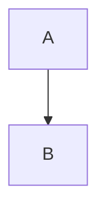

# Syntax reference

What Tandem Markdown draws: for each piece of syntax, what you type, what it becomes, which programs write it, and the setting that switches it. Anything not listed is read as standard markdown reads it, and can be edited as text. However a file is drawn, the file stays the same.

Every example below is one of the test cases in `test/panel/syntax/cases/`, which `harness/tests/syntax.spec.mjs` draws in Chrome to check what it shows. This file is generated from those cases, the table of optional syntax in `src/panel/syntax/` and the settings in `package.json` by `scripts/syntax-reference.mjs` (`npm run syntax-reference`). Change them, not this file.

## Contents

- [Standard markdown](#standard-markdown): [Backslash escapes and entities](#backslash-escapes-and-entities), [Bold and italic](#bold-and-italic), [Code blocks](#code-blocks), [Code in a line](#code-in-a-line), [Headings](#headings), [Indented code](#indented-code), [Line breaks](#line-breaks), [Lines of a paragraph](#lines-of-a-paragraph), [Links](#links), [Lists](#lists), [Pictures](#pictures), [Quotes](#quotes), [Rules](#rules)
- [GitHub](#github): [Alerts](#alerts), [Bare addresses](#bare-addresses), [Emoji codes](#emoji-codes), [Footnotes](#footnotes), [One tilde](#one-tilde), [One tilde as GitHub alone reads it](#one-tilde-as-github-alone-reads-it), [Pictures for one theme](#pictures-for-one-theme), [Strikethrough](#strikethrough), [Table cells](#table-cells), [Tables](#tables), [Task lists](#task-lists)
- [Notes tools](#notes-tools): [Bear's links to headings](#bears-links-to-headings), [Block ids](#block-ids), [Callouts](#callouts), [Comments](#comments), [Contents lists](#contents-lists), [Embedded notes](#embedded-notes), [Embedded pictures](#embedded-pictures), [Embedded video and sound](#embedded-video-and-sound), [Front matter](#front-matter), [Highlight](#highlight), [Highlight colors](#highlight-colors), [Logseq picture sizes](#logseq-picture-sizes), [Notes written in place](#notes-written-in-place), [Picture sizes after the alt text](#picture-sizes-after-the-alt-text), [Tags](#tags), [Tasks with other marks](#tasks-with-other-marks), [Wikilinks](#wikilinks), [Wikilinks in front matter](#wikilinks-in-front-matter), [Wikilinks to a heading or a block](#wikilinks-to-a-heading-or-a-block), [Wikilinks with the shown text first](#wikilinks-with-the-shown-text-first)
- [Document tools and site builders](#document-tools-and-site-builders): [Abbreviations](#abbreviations), [Code block titles](#code-block-titles), [Code languages in braces](#code-languages-in-braces), [Code that runs](#code-that-runs), [Definition lists](#definition-lists), [Docusaurus admonitions](#docusaurus-admonitions), [GitLab and Azure DevOps contents lists](#gitlab-and-azure-devops-contents-lists), [GitLab quotes](#gitlab-quotes), [Grid tables](#grid-tables), [Heading attributes](#heading-attributes), [JSON front matter](#json-front-matter), [Line marks after the language](#line-marks-after-the-language), [MkDocs admonitions](#mkdocs-admonitions), [MkDocs content tabs](#mkdocs-content-tabs), [MkDocs folding admonitions](#mkdocs-folding-admonitions), [One tilde as Pandoc alone reads it](#one-tilde-as-pandoc-alone-reads-it), [Pandoc fenced divs](#pandoc-fenced-divs), [Picture sizes after the address](#picture-sizes-after-the-address), [Picture sizes in braces](#picture-sizes-in-braces), [Pictures for one theme in MkDocs](#pictures-for-one-theme-in-mkdocs), [Pictures stored in the file](#pictures-stored-in-the-file), [Quarto callouts](#quarto-callouts), [Styled spans](#styled-spans), [Subscript and superscript](#subscript-and-superscript), [TOML front matter](#toml-front-matter), [Tracked changes](#tracked-changes), [Video written as a picture](#video-written-as-a-picture), [VitePress containers](#vitepress-containers), [VitePress contents lists](#vitepress-contents-lists), [Word bookmarks](#word-bookmarks)
- [HTML](#html): [Aligned blocks](#aligned-blocks), [Anchors](#anchors), [Folding sections](#folding-sections), [HTML blocks](#html-blocks), [HTML comments](#html-comments), [HTML split by blank lines](#html-split-by-blank-lines), [Keys](#keys), [Line breaks in HTML](#line-breaks-in-html), [Links in HTML](#links-in-html), [Notion's asides](#notions-asides), [Pictures for each theme in HTML](#pictures-for-each-theme-in-html), [Pictures in HTML](#pictures-in-html), [Subscript and superscript in HTML](#subscript-and-superscript-in-html), [Underline, highlight and spans](#underline-highlight-and-spans), [Video and sound in HTML](#video-and-sound-in-html)
- [Math and diagrams](#math-and-diagrams): [LaTeX environments](#latex-environments), [LaTeX math blocks](#latex-math-blocks), [LaTeX math in a line](#latex-math-in-a-line), [Math blocks](#math-blocks), [Math code blocks](#math-code-blocks), [Math in a line](#math-in-a-line), [Math in a line with backticks](#math-in-a-line-with-backticks), [Math with doubled backslashes](#math-with-doubled-backslashes), [Mermaid between colons](#mermaid-between-colons), [Mermaid diagrams](#mermaid-diagrams)
- [Git](#git): [Git's conflict markers](#gits-conflict-markers)
- [Shown as typed](#shown-as-typed): [Attributes after other blocks and words](#attributes-after-other-blocks-and-words), [Azure DevOps sub-page lists](#azure-devops-sub-page-lists), [Citations](#citations), [Embedded PDFs](#embedded-pdfs), [Embeds inside a sentence](#embeds-inside-a-sentence), [Environments KaTeX cannot draw](#environments-katex-cannot-draw), [HTML elements GitHub refuses](#html-elements-github-refuses), [Inserted text](#inserted-text), [Math in a line over two lines](#math-in-a-line-over-two-lines), [MultiMarkdown's notes written in place](#multimarkdowns-notes-written-in-place), [Notes written in place over two lines](#notes-written-in-place-over-two-lines), [Other contents markers](#other-contents-markers), [Spans with other classes](#spans-with-other-classes), [Superscript after a space](#superscript-after-a-space), [Tasks that do not apply](#tasks-that-do-not-apply), [Template tags and shortcodes](#template-tags-and-shortcodes), [Text shaped like a tag](#text-shaped-like-a-tag)
- [Drawn wrongly](#drawn-wrongly): [Strikes straight after a word](#strikes-straight-after-a-word)
- [Settings](#settings)

## Standard markdown

CommonMark, which every markdown program writes. It is always on.

### Backslash escapes and entities

```markdown
\*Not italic\*, &copy; &amp; &#169; &#xA9;.
```

The character itself: the backslash before it is hidden, and an entity shows as the character it names.

### Bold and italic

```markdown
**Bold**, __bold__, *italic*, _italic_ and ***both***.
```

Bold and italic text.

### Code blocks

````markdown
```js
let a = 1;
```

~~~python
print(1)
~~~
````

A code block colored as its language, with the language's name and a Copy button above it.

### Code in a line

```markdown
Run `npm ci` first, or ``a `tick` inside``.
```

Code, set apart from the text. Two backticks around it let it hold one.

### Headings

```markdown
# A heading

### A smaller heading

An underlined heading
=====================

A smaller one
-------------
```

A heading. `#` to `######` give the six levels, and a line of `=` or `-` under the text gives the first two.

### Indented code

```markdown
Text.

    indented code

Text.
```

A code block.

### Line breaks

```markdown
Two spaces  
and a backslash\
break a line.
```

A line break. The backslash is hidden.

### Lines of a paragraph

```markdown
One line of a paragraph
and the next line of it.
```

Each line of the file stays a line of its own, where CommonMark joins them into one.

### Links

```markdown
An [inline link](https://example.com "Title"), a [reference link][ref], <https://example.com>, [a file](Other%20note.md) and [a heading](#a-heading).

[ref]: https://example.com
```

A link showing its text. A click opens it in Rich view, and Ctrl+click (Cmd+click on a Mac) in Rich editor. A reference link's definition is left out of Rich view.

### Lists

```markdown
- An item
- Another, holding

  a second paragraph
  - and a list

3. Numbered from three
4. Four

1) With a parenthesis
```

A bulleted or numbered list. A numbered list starts at its first number, and an item can hold paragraphs, code and other lists.

### Pictures

```markdown
 and ![a reference][pic]

[pic]: chart.png
```

The picture, from the workspace, or from an https address while `tandemMarkdown.images.allowRemote` is on. A picture that cannot be shown says why in its place.

### Quotes

```markdown
> A quote
with an unmarked line,
>
> > and a quote inside it.
```

A quote with a bar beside it. Quotes nest, and a line with no `>` goes on with the quote above it.

### Rules

```markdown
Above.

---

***

Below.
```

A line across the page.

## GitHub

What GitHub adds to standard markdown. Its tables, task lists, strikethrough with two tildes and bare addresses are always on; each of its other additions has a setting.

### Alerts

```markdown
> [!NOTE]
> Useful information.
```

A colored box with its type's icon and name: `NOTE`, `TIP`, `IMPORTANT`, `WARNING` or `CAUTION`.

Written by GitHub, GitLab, Typora, VitePress and Bear. Setting: [`tandemMarkdown.syntax.callouts`](#tandemmarkdownsyntaxcallouts), on by default.

### Bare addresses

```markdown
Visit https://example.com, www.example.com or write to someone@example.com.
```

Links: web addresses, addresses that start with `www.`, and email addresses.

Written by GitHub, GitLab and Obsidian. Always on.

### Emoji codes

```markdown
Nice :smile: and :rocket: here.
```

The emoji, for the names on GitHub's list, with its code as a tooltip. A time such as `12:30:45` stays text.

Written by GitHub, GitLab, Azure DevOps, Typora, Docusaurus and Material for MkDocs. Setting: [`tandemMarkdown.syntax.emoji`](#tandemmarkdownsyntaxemoji), on by default.

### Footnotes

```markdown
A claim.[^1]

[^1]: The note.
```

The reference shows its note's number, counted in the order the notes are first referred to, as GitHub counts them, and the note shows the same number. Pointing at a reference shows the note's text, and it opens as a link does, going to the note and back.

Written by GitHub, GitLab, Obsidian, Pandoc, MultiMarkdown, Typora and Joplin. Setting: [`tandemMarkdown.syntax.footnotes`](#tandemmarkdownsyntaxfootnotes), on by default.

### One tilde

```markdown
A ~gone~ word.
```

Struck-through text, by GitHub's rule: a tilde after a space never closes it, so `~5 to ~10` stays text. A pair straight after a letter, a digit or a closing bracket, with no space inside, is subscript instead (see Subscript and superscript).

Written by GitHub and MarkDownload. Setting: [`tandemMarkdown.syntax.tilde`](#tandemmarkdownsyntaxtilde) at `both`, the default.

### One tilde as GitHub alone reads it

```markdown
Water is H~2~O.
```

The 2 struck through: with `tandemMarkdown.syntax.tilde` at `strikethrough`, every pair of single tildes is struck through by GitHub's rule, and carets are text.

Written by GitHub. Setting: [`tandemMarkdown.syntax.tilde`](#tandemmarkdownsyntaxtilde) set to `strikethrough`; the default is `both`.

### Pictures for one theme

```markdown


```

Each picture shown only while the editor's theme is dark (`#gh-dark-mode-only`) or light (`#gh-light-mode-only`).

Written by GitHub. Setting: [`tandemMarkdown.syntax.themePictures`](#tandemmarkdownsyntaxthemepictures), on by default.

### Strikethrough

```markdown
~~Two tildes~~ strike through.
```

Struck-through text.

Written by GitHub and nearly every other program. Always on.

### Table cells

```markdown
| What | Example |
|---|---|
| Formatting | **bold**, `code` and ==marked== |
| Links | [[Other note]] and #active |
| Math | $E = mc^2$ |
| Emoji | :tada: |
```

A cell draws what a line draws: formatting, links and wikilinks, tags, emoji, math, footnotes, pictures and HTML, each under its own setting. What is a block by nature, such as a contents list or a block id, shows as typed in a cell, and an embedded note shows as a link to it. A `|` in a cell is written `\|`, in a link's shown text and a picture's size too.

Written by GitHub, GitLab, Obsidian and Pandoc. Always on.

### Tables

```markdown
| Left | Center | Right |
|:-----|:------:|------:|
| a    | **b**  | `c`   |
| one<br>two | d | e |
```

A table. Colons in the line of dashes align its columns, cells hold formatting, and `<br>` breaks a line in a cell. A click on a cell edits that cell alone.

Written by GitHub and nearly every other program. Always on.

### Task lists

```markdown
- [x] Done
- [ ] To do
```

Checkboxes. A click checks or unchecks one, in Rich view too.

Written by GitHub and nearly every other program. Always on.

## Notes tools

What Obsidian, Foam, Logseq, Bear, Dendron and other notes programs write.

### Bear's links to headings

```markdown
See [[Other note/Part two]] and [[Other note/Part three|the end]].
```

A link to the heading "Part two" in the note "Other note", as Bear means it, when no note "Part two" sits in a folder "Other note" and the note "Other note" has that heading. When a note answers the folder path, the link goes to it, as Obsidian and Foam read it.

Written by Bear. Setting: [`tandemMarkdown.syntax.wikilinks`](#tandemmarkdownsyntaxwikilinks) at `noteFirst`, the default.

### Block ids

```markdown
A paragraph. ^quote-1
```

Hidden in Rich view and faded in Rich editor. An embed or a link names the block by it.

Written by Obsidian, Foam and Dendron. Setting: [`tandemMarkdown.syntax.blockIds`](#tandemmarkdownsyntaxblockids), on by default.

### Callouts

```markdown
> [!faq]- Are callouts foldable?
> Yes!
```

A colored box of one of Obsidian's thirteen types and their aliases, with its title. A `-` after the type starts it folded and a `+` open, and a click on its arrow opens and closes it. Callouts nest.

Written by Obsidian, Hugo and Markdown Preview Enhanced. Setting: [`tandemMarkdown.syntax.callouts`](#tandemmarkdownsyntaxcallouts), on by default.

### Comments

```markdown
Visible %%hidden%% text.
```

Hidden in Rich view and faded in Rich editor. A `%%` on a line of its own starts a comment that runs to the next one.

Written by Obsidian. Setting: [`tandemMarkdown.syntax.comments`](#tandemmarkdownsyntaxcomments), on by default.

### Contents lists

```markdown
# Title

[TOC]

## One

### Deeper

## Two
```

A list of the file's headings, each a link to its heading, kept current as the headings change. `[toc]` works too.

Written by Typora, Joplin, Python-Markdown and Markdown Preview Enhanced. Setting: [`tandemMarkdown.syntax.contents`](#tandemmarkdownsyntaxcontents), on by default.

### Embedded notes

```markdown
![[Other note#^quote-1]]
```

The note, or its section or block, drawn in place and read-only on a line of its own, with a button that opens the note. It needs wikilinks on.

Written by Obsidian, Foam, Dendron and Markdown Preview Enhanced. Setting: [`tandemMarkdown.syntax.embeds`](#tandemmarkdownsyntaxembeds), on by default.

### Embedded pictures

```markdown
![[pic.png|300|center]]
```

The picture, at the width (or width and height) after the bar. Foam's form also places it left, center or right.

Written by Obsidian and Foam. Setting: [`tandemMarkdown.syntax.wikilinks`](#tandemmarkdownsyntaxwikilinks) at `noteFirst`, the default.

### Embedded video and sound

```markdown
![[talk.ogg]]
```

A player, which never starts by itself.

Written by Obsidian. Setting: [`tandemMarkdown.syntax.media`](#tandemmarkdownsyntaxmedia), off by default.

### Front matter

```markdown
---
title: A note
tags: [travel, food]
---

Text.
```

A table of names and values, from YAML or from JSON between the `---` lines. `tandemMarkdown.frontmatter.display` chooses a table (the default), the text as typed, or hiding it in Rich view.

Written by Obsidian, Jekyll, Hugo, MkDocs, Docusaurus and Pandoc. Always on.

### Highlight

```markdown
Some ==highlighted== words.
```

Highlighted text.

Written by Obsidian, Bear, Joplin, Typora and Markdown Preview Enhanced. Setting: [`tandemMarkdown.syntax.highlight`](#tandemmarkdownsyntaxhighlight), on by default.

### Highlight colors

```markdown
An ==🔴Important== and a ==🟢Completed== note.
```

Highlighted text in the color the emoji names, the emoji hidden: red, orange, yellow, green, blue or purple.

Written by Obsidian and Bear. Setting: [`tandemMarkdown.syntax.highlightColors`](#tandemmarkdownsyntaxhighlightcolors), on by default.

### Logseq picture sizes

```markdown
{:height 452, :width 785}
```

The picture at that size, the braces hidden.

Written by Logseq. Setting: [`tandemMarkdown.syntax.otherPictureSizes`](#tandemmarkdownsyntaxotherpicturesizes), off by default.

### Notes written in place

```markdown
A claim.^[The note itself.] More.
```

A footnote, numbered with the others. Pointing at it shows the note's text.

Written by Obsidian, Pandoc, Joplin and VitePress. Setting: [`tandemMarkdown.syntax.footnotes`](#tandemmarkdownsyntaxfootnotes), on by default.

### Picture sizes after the alt text

```markdown
 and 
```

The picture at that width, or width and height.

Written by Obsidian. Setting: [`tandemMarkdown.syntax.pictureSizes`](#tandemmarkdownsyntaxpicturesizes), on by default.

### Tags

```markdown
A line with #project and #area/sub tags.
```

A label. Ctrl+click (Cmd+click on a Mac) searches the workspace for it. By Obsidian's rule a color code such as `#ff0000` is a tag, and a number such as `#123` is not.

Written by Obsidian, Foam, Bear, Logseq and Dendron. Setting: [`tandemMarkdown.syntax.tags`](#tandemmarkdownsyntaxtags), on by default.

### Tasks with other marks

```markdown
- [?] A question
- [-] Dropped
- [/] Half done
- [x] Done
- [ ] To do
```

A box showing the mark, which a click does not check.

Written by Obsidian. Setting: [`tandemMarkdown.syntax.taskMarks`](#tandemmarkdownsyntaxtaskmarks), on by default.

### Wikilinks

```markdown
See [[Other note]] and [[folder/Other note|an alias]].
```

A link to the note, found by the end of its path, showing the text after the bar when there is one. Typing `[[` offers notes.

Written by Obsidian, Foam, Logseq, Bear and Markdown Preview Enhanced. Setting: [`tandemMarkdown.syntax.wikilinks`](#tandemmarkdownsyntaxwikilinks) at `noteFirst`, the default.

### Wikilinks in front matter

```markdown
---
author: "[[Other note]]"
---

Text.
```

Links in the front matter's table, opened as other links are.

Written by Obsidian. Setting: [`tandemMarkdown.syntax.wikilinks`](#tandemmarkdownsyntaxwikilinks) at `noteFirst`, the default.

### Wikilinks to a heading or a block

```markdown
[[Other note#Part two]] and [[Other note#^quote-1]]
```

A link to that heading, or to the block with that id, in the note.

Written by Obsidian, Foam, Dendron and Markdown Preview Enhanced. Setting: [`tandemMarkdown.syntax.wikilinks`](#tandemmarkdownsyntaxwikilinks) at `noteFirst`, the default.

### Wikilinks with the shown text first

```markdown
See [[the other note|Other note]] today.
```

A link to the note after the bar, showing the text before it.

Written by Dendron and GitLab wikis. Setting: [`tandemMarkdown.syntax.wikilinks`](#tandemmarkdownsyntaxwikilinks) set to `textFirst`; the default is `noteFirst`.

## Document tools and site builders

What Pandoc, Quarto, R Markdown, MkDocs, VitePress, Docusaurus, Hugo, kramdown, GitLab and Azure DevOps write.

### Abbreviations

```markdown
The HTML specification is maintained by the W3C.

*[HTML]: Hyper Text Markup Language
*[W3C]:  World Wide Web Consortium
```

Each use of the abbreviation shows its meaning as a tooltip, and the definition is left out of Rich view.

Written by PHP Markdown Extra, Python-Markdown, kramdown and Material for MkDocs. Setting: [`tandemMarkdown.syntax.abbreviations`](#tandemmarkdownsyntaxabbreviations), on by default.

### Code block titles

````markdown
```js title="app.js" {1,4-6} showLineNumbers
console.log(1);
```
````

A code block with the title in its header.

Written by Docusaurus and Material for MkDocs. Setting: [`tandemMarkdown.syntax.codeFenceLabels`](#tandemmarkdownsyntaxcodefencelabels), on by default.

### Code languages in braces

````markdown
```{.python}
print('hi')
```
````

A code block labeled and colored as that language: the first class in the braces, wherever it stands, so `{#id .haskell}` is Haskell.

Written by Pandoc and Quarto. Setting: [`tandemMarkdown.syntax.codeFenceLabels`](#tandemmarkdownsyntaxcodefencelabels), on by default.

### Code that runs

````markdown
```{r label, echo=FALSE}
plot(cars)
```

```{python}
#| echo: false
print(1)
```
````

A code block in that language. The code is shown, not run.

Written by R Markdown and Quarto. Setting: [`tandemMarkdown.syntax.codeFenceLabels`](#tandemmarkdownsyntaxcodefencelabels), on by default.

### Definition lists

```markdown
Term
: Its definition

After
```

The term in bold, its definition indented beneath it.

Written by Pandoc, PHP Markdown Extra, kramdown, Python-Markdown and MultiMarkdown. Setting: [`tandemMarkdown.syntax.definitionLists`](#tandemmarkdownsyntaxdefinitionlists), on by default.

### Docusaurus admonitions

```markdown
:::tip[Use the **docs**]

Some content.

:::
```

A box with a callout's look and the title in brackets.

Written by Docusaurus. Setting: [`tandemMarkdown.syntax.boxes`](#tandemmarkdownsyntaxboxes), on by default.

### GitLab and Azure DevOps contents lists

```markdown
[[_TOC_]]

# A
```

A list of the file's headings, as `[TOC]` gives.

Written by GitLab and Azure DevOps. Setting: [`tandemMarkdown.syntax.contents`](#tandemmarkdownsyntaxcontents), on by default.

### GitLab quotes

```markdown
>>>
A quote over
several lines.
>>>

After.
```

A quote. Drawn while `tandemMarkdown.syntax.boxes` is on.

Written by GitLab. Setting: [`tandemMarkdown.syntax.fencedQuotes`](#tandemmarkdownsyntaxfencedquotes), off by default.

### Grid tables

```markdown
+---------------+---------------+--------------------+
| Fruit         | Price         | Advantages         |
+===============+===============+====================+
| Bananas       | $1.34         | - built-in wrapper |
|               |               | - bright color     |
+---------------+---------------+--------------------+
| Oranges       | **$2.10**     | - cures scurvy     |
|               |               | - tasty            |
+---------------+---------------+--------------------+

After
```

A table whose cells can hold paragraphs and lists. Its cells are edited in its source, which its pencil or the cursor opens.

Written by Pandoc. Setting: [`tandemMarkdown.syntax.gridTables`](#tandemmarkdownsyntaxgridtables), on by default.

### Heading attributes

```markdown
# Intro {#intro .big}
Text.
```

The braces are hidden, and an `#id` in them is the heading's link address.

Written by Pandoc, kramdown, Hugo, Python-Markdown and Google Docs' export. Setting: [`tandemMarkdown.syntax.headingAttributes`](#tandemmarkdownsyntaxheadingattributes), on by default.

### JSON front matter

```markdown
;;;
{
  "title": "JSON",
  "weight": 1.0
}
;;;
Text
```

A table of names and values, from JSON between `;;;` lines or a bare JSON object at the top of the file.

Written by GitLab and Hugo. Setting: [`tandemMarkdown.syntax.jsonFrontmatter`](#tandemmarkdownsyntaxjsonfrontmatter), off by default.

### Line marks after the language

````markdown
```js{1,4}
let a = 1;
```
````

A code block in that language.

Written by VitePress and Hugo. Setting: [`tandemMarkdown.syntax.codeFenceLabels`](#tandemmarkdownsyntaxcodefencelabels), on by default.

### MkDocs admonitions

```markdown
!!! note "Phasellus posuere in sem ut cursus"

    Lorem ipsum dolor sit amet.

After it.
```

A box with a callout's look and the title in quotes, its body indented four spaces. A type no callout has takes the note's look.

Written by Material for MkDocs and Python-Markdown. Setting: [`tandemMarkdown.syntax.boxes`](#tandemmarkdownsyntaxboxes), on by default.

### MkDocs content tabs

```markdown
=== "Python"

    print(1)

=== "Shell"

    echo 1
```

Each tab as a box under its title. Drawn while `tandemMarkdown.syntax.boxes` is on.

Written by Material for MkDocs. Setting: [`tandemMarkdown.syntax.contentTabs`](#tandemmarkdownsyntaxcontenttabs), off by default.

### MkDocs folding admonitions

```markdown
??? question "Why?"
    Because.

???+ tip "Open"
    Shown.
```

A box that folds, closed for `???` and open for `???+`.

Written by Material for MkDocs. Setting: [`tandemMarkdown.syntax.boxes`](#tandemmarkdownsyntaxboxes), on by default.

### One tilde as Pandoc alone reads it

```markdown
A ~word~ and ^note^ here.
```

Subscript and superscript wherever the pair stands, as Pandoc draws them, with `tandemMarkdown.syntax.tilde` at `subscript`.

Written by Pandoc. Setting: [`tandemMarkdown.syntax.tilde`](#tandemmarkdownsyntaxtilde) set to `subscript`; the default is `both`.

### Pandoc fenced divs

```markdown
::: Warning
This is a warning.

::: Danger
This is a warning within a warning.
:::
:::
```

A box for each div, nested as written. A class a callout has, such as `Warning`, gives the callout's look, and any other class a plain box labeled with it.

Written by Pandoc and R Markdown. Setting: [`tandemMarkdown.syntax.boxes`](#tandemmarkdownsyntaxboxes), on by default.

### Picture sizes after the address

```markdown

```

The picture at that size.

Written by Azure DevOps. Setting: [`tandemMarkdown.syntax.otherPictureSizes`](#tandemmarkdownsyntaxotherpicturesizes), off by default.

### Picture sizes in braces

```markdown
Before {width=50%} after.
```

The picture at that size, the braces hidden. Pandoc writes a size like this for every picture in a Word file.

Written by Pandoc, Quarto and GitLab. Setting: [`tandemMarkdown.syntax.pictureSizes`](#tandemmarkdownsyntaxpicturesizes), on by default.

### Pictures for one theme in MkDocs

```markdown

```

The picture, shown only while the editor's theme is dark (`#only-dark`) or light (`#only-light`).

Written by Material for MkDocs. Setting: [`tandemMarkdown.syntax.themePictures`](#tandemmarkdownsyntaxthemepictures), on by default.

### Pictures stored in the file

```markdown
![][image1]

[image1]: <data:image/png;base64,iVBORw0KGgoAAAANSUhEUgAAAAEAAAABCAYAAAAfFcSJAAAADUlEQVR42mNkYPhfDwAChwGA60e6kgAAAABJRU5ErkJggg==>
```

The picture, drawn from the file with nothing fetched. PNG, JPEG, GIF and WebP pictures are drawn; another kind says why it is not.

Written by Google Docs' export and Notion's export. Always on.

### Quarto callouts

```markdown
::: {.callout-note title="Heads up"}
The body.
:::
```

A callout of that type, titled by its `title` or by the heading that opens it. `collapse="true"` folds it.

Written by Quarto. Setting: [`tandemMarkdown.syntax.boxes`](#tandemmarkdownsyntaxboxes), on by default.

### Styled spans

```markdown
Some [underlined]{.underline}, [small caps]{.smallcaps} and [marked]{.mark} text.
```

Underlined text, small capitals and highlighted text.

Written by Pandoc. Setting: [`tandemMarkdown.syntax.spans`](#tandemmarkdownsyntaxspans), on by default.

### Subscript and superscript

```markdown
Water is H~2~O and x^2^ is a square.
```

Subscript and superscript, as Pandoc reads them, for a pair of tildes or carets straight after a letter, a digit or a closing bracket with no space inside. A space escaped with a backslash counts as none (`X~long\ text~`).

Written by Pandoc, Quarto, Typora, Joplin and Markdown Preview Enhanced. Setting: [`tandemMarkdown.syntax.tilde`](#tandemmarkdownsyntaxtilde) at `both`, the default.

### TOML front matter

```markdown
+++
title = "My post"
date = 1979-05-27T07:32:00Z
tags = ["travel", "food"]
draft = false

[params]
author = 'Jane'
+++
# Body
```

A table of names and values, as YAML front matter is drawn.

Written by Hugo. Setting: [`tandemMarkdown.syntax.tomlFrontmatter`](#tandemmarkdownsyntaxtomlfrontmatter), on by default.

### Tracked changes

```markdown
An {++added++}, a {--cut--}, an {~~old~>new~~}, a {==marked==}{>>with a comment<<} word.
```

Additions, deletions and replacements in color, highlighted text, and comments set apart.

Written by MultiMarkdown and PyMdown Extensions. Setting: [`tandemMarkdown.syntax.criticMarkup`](#tandemmarkdownsyntaxcriticmarkup), off by default.

### Video written as a picture

```markdown

```

A player, which never starts by itself.

Written by GitLab and Logseq. Setting: [`tandemMarkdown.syntax.media`](#tandemmarkdownsyntaxmedia), off by default.

### VitePress containers

```markdown
::: danger STOP
Danger zone, do not proceed.
:::
```

A box with the title after its name. A name a callout has, such as `info`, `tip`, `warning` or `danger`, gives the callout's look, any other name a plain box labeled with it, and `details` folds.

Written by VitePress and markdown-it-container. Setting: [`tandemMarkdown.syntax.boxes`](#tandemmarkdownsyntaxboxes), on by default.

### VitePress contents lists

```markdown
[[toc]]

# A

## B
```

A list of the file's headings, as `[TOC]` gives, in any letter case. When the workspace has a note named "toc", it stays a link to that note, as Obsidian and Foam read it.

Written by VitePress and Joplin. Setting: [`tandemMarkdown.syntax.contents`](#tandemmarkdownsyntaxcontents), on by default.

### Word bookmarks

```markdown
# []{#_Toc123 .anchor}Introduction

Text []{#_Ref9 .anchor}here.
```

Hidden. A link to the bookmark still goes to it.

Written by Pandoc, from Word files. Setting: [`tandemMarkdown.syntax.spans`](#tandemmarkdownsyntaxspans), on by default.

## HTML

HTML is drawn as GitHub draws it, through the same list of allowed elements. In a workspace VS Code does not trust, it shows as typed.

### Aligned blocks

```markdown
<div align="center">

# Title

Centered **words**.

</div>

After.
```

The markdown inside, aligned as `align` says. The tag lines are hidden until the cursor is on them. `<p align>`, `<center>` and HTML marked `markdown` work the same way.

Written by GitHub, Python-Markdown and Material for MkDocs. Always on.

### Anchors

```markdown
<a name="here"></a>Jump [there](#here).
```

Hidden. A link to `#here` goes to it.

Written by GitHub. Always on.

### Folding sections

```markdown
Above.

<details>
<summary>More <b>here</b></summary>

**Inside** text.

</details>

Below.
```

A section folded under its summary, open if `open` says so. A click on the summary folds or unfolds it without changing the file, and the markdown inside is drawn and edited as anywhere.

Written by GitHub, GitLab and Azure DevOps. Always on.

### HTML blocks

```markdown
<table>
  <tr><th>Name</th><th>Size</th></tr>
  <tr><td>a.md</td><td>2 KB</td></tr>
</table>
```

Drawn as a browser draws it, through the elements GitHub allows. Its pencil, or the cursor, opens its source.

Written by GitHub, Pandoc and Jupyter's export. Always on.

### HTML comments

```markdown
Text <!-- a comment --> more.

<!--
A comment block.
-->

After.
```

Hidden in Rich view, and shown in Rich editor.

Written by GitHub, Hugo, Docusaurus and Markdown Preview Enhanced. Always on.

### HTML split by blank lines

```markdown
<table>
<tr>
<td>

**Cell**

</td>
</tr>
</table>
```

Code. Each part leaves elements open for the next, so none of them can be drawn on its own.

Written by GitHub. Always on.

### Keys

```markdown
Press <kbd>Ctrl</kbd>+<kbd>S</kbd>.
```

Key caps. As with all HTML in a line, the tags are hidden until the cursor is in them.

Written by GitHub and GitLab. Always on.

### Line breaks in HTML

```markdown
line<br>break
```

A line break.

Written by GitHub, GitLab and Azure DevOps. Always on.

### Links in HTML

```markdown
See <a href="https://example.com/docs">the docs</a> now.
```

A link, opened as a markdown link is. A link whose address GitHub refuses, such as `javascript:`, is its text alone.

Written by GitHub and web clippers. Always on.

### Notion's asides

```markdown
<aside>
💡 Remember the milk.
</aside>
```

A block with its text.

Written by Notion. Always on.

### Pictures for each theme in HTML

```markdown
<picture>
  <source media="(prefers-color-scheme: dark)" srcset="logo-dark.png">
  <source media="(prefers-color-scheme: light)" srcset="logo-light.png">
  
</picture>
```

The picture for the theme in use.

Written by GitHub. Always on.

### Pictures in HTML

```markdown
A  dot.
```

The picture, at the size its attributes give.

Written by GitHub and Typora. Always on.

### Subscript and superscript in HTML

```markdown
H<sub>2</sub>O and x<sup>2</sup>
```

Subscript and superscript.

Written by GitHub and web clippers. Always on.

### Underline, highlight and spans

```markdown
An <u>underlined</u>, <mark>marked</mark> and <span style="color:red">plain</span> word.
```

Underlined and highlighted text. A `style` is dropped, as GitHub drops it.

Written by Pandoc, MarkItDown and web clippers. Always on.

### Video and sound in HTML

```markdown
<video src="clip.mp4" controls autoplay></video>
```

A player, which never starts by itself, even when `autoplay` asks it to.

Written by Typora, Azure DevOps and web clippers. Setting: [`tandemMarkdown.syntax.media`](#tandemmarkdownsyntaxmedia), off by default.

## Math and diagrams

Math is drawn by KaTeX and diagrams by Mermaid, each loaded the first time a file needs it.

### LaTeX environments

```markdown
\begin{align}
a &= b + c \\
d &= e
\end{align}
```

A formula on its own lines, for the environments KaTeX draws, such as `align`. Drawn while `tandemMarkdown.syntax.math` is on.

Written by Jupyter and Pandoc. Setting: [`tandemMarkdown.syntax.latexMath`](#tandemmarkdownsyntaxlatexmath), on by default.

### LaTeX math blocks

```markdown
Einstein wrote

\[
E = mc^2
\]

long ago.
```

A formula on its own lines, when the brackets stand as a paragraph of their own; inside a sentence they stay brackets. Drawn while `tandemMarkdown.syntax.math` is on.

Written by chat assistants and Markdown Preview Enhanced. Setting: [`tandemMarkdown.syntax.latexMath`](#tandemmarkdownsyntaxlatexmath), on by default.

### LaTeX math in a line

```markdown
The area is \(\pi r^2\) here.
```

A formula in the line. Drawn while `tandemMarkdown.syntax.math` is on.

Written by chat assistants and Markdown Preview Enhanced. Setting: [`tandemMarkdown.syntax.latexMath`](#tandemmarkdownsyntaxlatexmath), on by default.

### Math blocks

```markdown
$$
\int_0^1 x\,dx
$$
```

A formula on its own lines. Its pencil, or the cursor, opens its source, with the drawing kept beneath while you edit.

Written by GitHub, GitLab, Obsidian, Pandoc, Jupyter, Typora and Joplin. Setting: [`tandemMarkdown.syntax.math`](#tandemmarkdownsyntaxmath), on by default.

### Math code blocks

````markdown
```math
\sqrt{3}
```
````

A formula on its own lines, as a math block is drawn.

Written by GitHub, GitLab and Docusaurus. Setting: [`tandemMarkdown.syntax.math`](#tandemmarkdownsyntaxmath), on by default.

### Math in a line

```markdown
Inline $a^2 + b^2$ here.
```

A formula, drawn by KaTeX. Prices stay text: `$5 and $10` is not a formula, by the rule Pandoc and VS Code's preview follow.

Written by GitHub, GitLab, Obsidian, Pandoc, Jupyter, Typora and Joplin. Setting: [`tandemMarkdown.syntax.math`](#tandemmarkdownsyntaxmath), on by default.

### Math in a line with backticks

```markdown
Inline $`\sqrt{3}`$ here.
```

A formula in the line.

Written by GitHub and GitLab. Setting: [`tandemMarkdown.syntax.math`](#tandemmarkdownsyntaxmath), on by default.

### Math with doubled backslashes

```markdown
Inline \\(x^2\\) here.

\\[ y = 2 \\]
```

A formula. Drawn while `tandemMarkdown.syntax.math` is on.

Written by MultiMarkdown and Jupyter. Setting: [`tandemMarkdown.syntax.doubledLatexMath`](#tandemmarkdownsyntaxdoubledlatexmath), off by default.

### Mermaid between colons

```markdown
::: mermaid
graph LR;
A-->B
:::
```

A Mermaid diagram, while `tandemMarkdown.syntax.mermaid` is on too.

Written by Azure DevOps. Setting: [`tandemMarkdown.syntax.boxes`](#tandemmarkdownsyntaxboxes), on by default.

### Mermaid diagrams

````markdown

````

A diagram drawn by Mermaid, shown as a picture in the editor's light or dark theme. A diagram with a mistake shows Mermaid's message. Its pencil, or the cursor, opens its source.

Written by GitHub, GitLab, Obsidian, Typora, Joplin, Azure DevOps and Material for MkDocs. Setting: [`tandemMarkdown.syntax.mermaid`](#tandemmarkdownsyntaxmermaid), on by default.

## Git

What git leaves in a file it could not merge.

### Git's conflict markers

```markdown
<<<<<<< HEAD
Budget: 4,200, agreed with Dana on the 12th.
=======
Budget: 4,500.
>>>>>>> north-wall
```

A merge conflict, its two sides labeled with the names git gave them. Its lines are not read as markdown, where the line above `=======` would become a heading. In the Rich editor, three buttons keep one side or both. A link opens the note in Source at the conflict.

Written by git. Setting: [`tandemMarkdown.syntax.conflictMarkers`](#tandemmarkdownsyntaxconflictmarkers), on by default.

## Shown as typed

What other programs write that is not drawn. It shows exactly as typed, or as the plain link it holds, and can be edited as text.

### Attributes after other blocks and words

```markdown
A paragraph
{: .note}

An *emphasized*{.red} word.
```

The braces show as typed, and what they follow is drawn.

Written by kramdown, Python-Markdown and Hugo.

### Azure DevOps sub-page lists

```markdown
Pages [[_TOSP_]] and [[_TOC_]] here.
```

Shown as typed, not as links to notes. `[[_TOC_]]` inside a sentence is shown as typed too.

Written by Azure DevOps.

### Citations

```markdown
As shown [@doe99, p. 33] and by @smith04.
```

Shown as typed.

Written by Pandoc, Quarto and R Markdown.

### Embedded PDFs

```markdown
![[doc.pdf#page=3]]
```

A link to the document, not the document drawn in place.

Written by Obsidian.

### Embeds inside a sentence

```markdown
See ![[Other note]] here.
```

A link to the note, not the note drawn in place.

Written by Obsidian.

### Environments KaTeX cannot draw

```markdown
\begin{multline}
x
\end{multline}
```

Shown as typed.

Written by Pandoc and Jupyter.

### HTML elements GitHub refuses

```markdown
a <iframe src="x"></iframe> b
```

Shown as typed, faded. GitHub refuses them too.

### Inserted text

```markdown
An ++inserted++ word.
```

Shown as typed.

Written by Joplin, markdown-it-ins and Hugo.

### Math in a line over two lines

```markdown
Some $a +
b$ here.
```

Shown as typed: a formula in a line must end on the line it starts.

Written by Pandoc.

### MultiMarkdown's notes written in place

```markdown
A claim.[^This is the note] More.
```

Shown as typed.

Written by MultiMarkdown.

### Notes written in place over two lines

```markdown
A claim.^[The note
over two lines.] More.
```

Shown as typed: a note written in place must end on the line it starts.

Written by Obsidian and Pandoc.

### Other contents markers

```markdown
${toc}

{{TOC}}

* TOC
{:toc}

# A
```

Shown as typed: `${toc}`, MultiMarkdown's `{{TOC}}`, and kramdown's `{:toc}`, whose `* TOC` line is a list of one item.

Written by MultiMarkdown and kramdown.

### Spans with other classes

```markdown
A [span]{.red} and [words]{lang=fr} stay.
```

Shown as typed.

Written by Pandoc.

### Superscript after a space

```markdown
A ^note^ here.
```

Shown as typed: a caret pair is superscript only straight after a letter, a digit or a closing bracket, unless `tandemMarkdown.syntax.tilde` is `subscript`.

Written by Pandoc, Quarto, Typora and Joplin.

### Tasks that do not apply

```markdown
- [~] Not applicable
```

A list item with `[~]` shown as typed.

Written by GitLab.

### Template tags and shortcodes

```markdown


 and {{ page.title }}
```

Shown as typed.

Written by Hugo and Jekyll.

### Text shaped like a tag

```markdown
use <name> here
```

Shown as typed when it names no HTML element, where GitHub would show nothing.

## Drawn wrongly

What is read differently from the way the program that writes it means it.

### Strikes straight after a word

```markdown
The plan~was~ dropped.
```

Subscript, as Pandoc reads it, where GitHub strikes it through: a pair of single tildes straight after a letter, a digit or a closing bracket with no space inside is written the same way in both, and Pandoc's reading is taken. With `tandemMarkdown.syntax.tilde` at `strikethrough` it is struck through.

Written by GitHub and MarkDownload.

## Settings

Each of these settings switches syntax beyond standard markdown and GitHub's tables, task lists, strikethrough and bare addresses, and can be set per workspace folder. With one off, its text is read as standard markdown reads it, and the file is the same either way.

### `tandemMarkdown.syntax.wikilinks`

`noteFirst` by default. Draw `[[wikilinks]]` as links, and pictures embedded with `![[picture.png]]`: `noteFirst` reads the note before the bar, as Obsidian, Foam and Bear write them; `textFirst` reads the shown text first, as Dendron and GitLab wikis do; `off` shows them as typed.

- `noteFirst`: `[[note|shown text]]`, as Obsidian, Foam and Bear write them.
- `textFirst`: `[[shown text|note]]`, as Dendron and GitLab wikis write them.
- `off`: As typed.

Examples: [Bear's links to headings](#bears-links-to-headings), [Embedded pictures](#embedded-pictures), [Wikilinks](#wikilinks), [Wikilinks in front matter](#wikilinks-in-front-matter), [Wikilinks to a heading or a block](#wikilinks-to-a-heading-or-a-block), [Wikilinks with the shown text first](#wikilinks-with-the-shown-text-first).

### `tandemMarkdown.syntax.highlight`

On by default. Draw `==text==` as highlighted text.

Examples: [Highlight](#highlight).

### `tandemMarkdown.syntax.footnotes`

On by default. Draw footnotes: a reference, `[^1]`, as its note's number, the note numbered where it stands, and notes written in place, `^[text]`.

Examples: [Footnotes](#footnotes), [Notes written in place](#notes-written-in-place).

### `tandemMarkdown.syntax.tags`

On by default. Draw `#tags` as labels, by Obsidian's rule (a color code such as `#ff0000` is a tag; `#123` is not). Ctrl+click (Cmd+click on a Mac) searches the workspace for the tag.

Examples: [Tags](#tags).

### `tandemMarkdown.syntax.emoji`

On by default. Draw emoji codes on GitHub's list, such as `:smile:`, as the emoji.

Examples: [Emoji codes](#emoji-codes).

### `tandemMarkdown.syntax.callouts`

On by default. Draw GitHub's alerts and Obsidian's callouts, `> [!NOTE]`, as boxes. Off shows them as quotes.

Examples: [Alerts](#alerts), [Callouts](#callouts).

### `tandemMarkdown.syntax.math`

On by default. Draw math: `$…$` in a line (prices such as `$5 and $10` stay text), `$$…$$` blocks and `math` code blocks.

Examples: [Math blocks](#math-blocks), [Math code blocks](#math-code-blocks), [Math in a line](#math-in-a-line), [Math in a line with backticks](#math-in-a-line-with-backticks).

### `tandemMarkdown.syntax.pictureSizes`

On by default. Draw a picture at the size written in braces after it, `{width=50%}` (Pandoc, Quarto, GitLab), or after its alt text and a bar, as Obsidian writes it.

Examples: [Picture sizes after the alt text](#picture-sizes-after-the-alt-text), [Picture sizes in braces](#picture-sizes-in-braces).

### `tandemMarkdown.syntax.otherPictureSizes`

Off by default. Read a picture's size written after its address, `` (Azure DevOps), and in Logseq's braces, `{:height 200, :width 300}`.

Examples: [Logseq picture sizes](#logseq-picture-sizes), [Picture sizes after the address](#picture-sizes-after-the-address).

### `tandemMarkdown.syntax.media`

Off by default. Play video and sound files from the workspace where a file has `<video>` or `<audio>`, an embed such as `![[talk.ogg]]`, or a link to one written as a picture, ``. Nothing plays by itself; files from https addresses only while `tandemMarkdown.images.allowRemote` is on.

Examples: [Embedded video and sound](#embedded-video-and-sound), [Video written as a picture](#video-written-as-a-picture), [Video and sound in HTML](#video-and-sound-in-html).

### `tandemMarkdown.syntax.themePictures`

On by default. Show a picture whose address ends in `#gh-dark-mode-only` or `#only-dark` only with a dark theme, and one ending in `#gh-light-mode-only` or `#only-light` only with a light theme (GitHub, Material for MkDocs).

Examples: [Pictures for one theme](#pictures-for-one-theme), [Pictures for one theme in MkDocs](#pictures-for-one-theme-in-mkdocs).

### `tandemMarkdown.syntax.mermaid`

On by default. Draw `mermaid` code blocks as Mermaid diagrams.

Examples: [Mermaid diagrams](#mermaid-diagrams).

### `tandemMarkdown.syntax.contents`

On by default. Draw `[TOC]`, `[toc]`, `[[_TOC_]]` or `[[toc]]` (VitePress, in any letter case) on a line of its own as a list of the file's headings. `[[toc]]` stays a link when a note named toc answers it.

Examples: [Contents lists](#contents-lists), [GitLab and Azure DevOps contents lists](#gitlab-and-azure-devops-contents-lists), [VitePress contents lists](#vitepress-contents-lists).

### `tandemMarkdown.syntax.embeds`

On by default. Draw a note embedded with `![[Note]]`, `![[Note#Heading]]` or `![[Note#^id]]` on a line of its own as that note, its section or its block, read-only. Needs wikilinks.

Examples: [Embedded notes](#embedded-notes).

### `tandemMarkdown.syntax.blockIds`

On by default. Fade a block id such as `^quote-1` at the end of a paragraph in Rich editor, and hide it in Rich view.

Examples: [Block ids](#block-ids).

### `tandemMarkdown.syntax.conflictMarkers`

On by default. Draw git's conflict markers, a block from a `<<<<<<<` line to a `>>>>>>>` line, as one conflict with its sides labeled and buttons to keep either side or both. Off, the lines are read as any other markdown.

Examples: [Git's conflict markers](#gits-conflict-markers).

### `tandemMarkdown.syntax.tilde`

`both` by default. How to read a pair of single tildes or carets. `both` reads each pair as the program that writes it means it: one straight after a letter, a digit or a closing bracket (`)`, `]` or `}`) with no space inside (`H~2~O`, `x~i~`, `x^2^`) is subscript or superscript, as Pandoc, Quarto, Typora and Joplin read them, and any other `~text~` is struck through by GitHub's rule, so `~5 to ~10` stays text; `strikethrough` strikes every `~text~` through, as GitHub does; `subscript` reads every pair with no space inside as subscript or superscript, as Pandoc does; `off` shows them as typed. A space escaped with a backslash counts as no space, an escaped tilde or caret is text, and nothing in code is read. Two tildes always strike through.

- `both`: `H~2~O` and `x^2^` as subscript and superscript, as Pandoc draws them, and any other `~text~` struck through, as GitHub draws it.
- `strikethrough`: `~text~` struck through, as GitHub draws it.
- `subscript`: `H~2~O` and `x^2^` as subscript and superscript, as Pandoc draws them.
- `off`: As typed.

Examples: [One tilde](#one-tilde), [One tilde as GitHub alone reads it](#one-tilde-as-github-alone-reads-it), [One tilde as Pandoc alone reads it](#one-tilde-as-pandoc-alone-reads-it), [Subscript and superscript](#subscript-and-superscript).

### `tandemMarkdown.syntax.comments`

On by default. Fade Obsidian's comments, `%%text%%` and blocks between `%%` lines, in the Rich editor, and hide them in Rich view.

Examples: [Comments](#comments).

### `tandemMarkdown.syntax.taskMarks`

On by default. Draw tasks with another mark in the box, such as `- [?]` and `- [-]` (Obsidian), as boxes showing the mark. A click does not check them.

Examples: [Tasks with other marks](#tasks-with-other-marks).

### `tandemMarkdown.syntax.highlightColors`

On by default. Draw a highlight whose text starts with a color emoji, such as `==🔴Important==`, in that color, the emoji hidden (Obsidian's six colors; Bear writes five of them).

Examples: [Highlight colors](#highlight-colors).

### `tandemMarkdown.syntax.boxes`

On by default. Draw `:::` blocks (Pandoc, Quarto, VitePress, Docusaurus) and `!!!` admonitions (MkDocs) as boxes; a name such as `note` or `warning` gives a callout's look, and `??? note` folds.

Examples: [Docusaurus admonitions](#docusaurus-admonitions), [MkDocs admonitions](#mkdocs-admonitions), [MkDocs folding admonitions](#mkdocs-folding-admonitions), [Pandoc fenced divs](#pandoc-fenced-divs), [Quarto callouts](#quarto-callouts), [VitePress containers](#vitepress-containers), [Mermaid between colons](#mermaid-between-colons).

### `tandemMarkdown.syntax.headingAttributes`

On by default. Hide attributes in braces after a heading, `## Title {#intro}` (Pandoc, kramdown, Hugo), and take the `#id` as the heading's link address.

Examples: [Heading attributes](#heading-attributes).

### `tandemMarkdown.syntax.spans`

On by default. Draw Pandoc's styled spans, `[text]{.underline}`, `{.smallcaps}` and `{.mark}`, and hide the bookmarks Word leaves, `[]{#_Toc12 .anchor}`, which links still jump to.

Examples: [Styled spans](#styled-spans), [Word bookmarks](#word-bookmarks).

### `tandemMarkdown.syntax.tomlFrontmatter`

On by default. Draw TOML front matter, between `+++` lines at the top of a file (Hugo), as a table, as YAML front matter is drawn.

Examples: [TOML front matter](#toml-front-matter).

### `tandemMarkdown.syntax.jsonFrontmatter`

Off by default. Draw JSON front matter at the top of a file, between `;;;` lines (GitLab) or as a bare `{…}` object (Hugo), as a table.

Examples: [JSON front matter](#json-front-matter).

### `tandemMarkdown.syntax.definitionLists`

On by default. Draw definition lists, a term on its own line and then `: Its definition` (Pandoc, PHP Markdown Extra, kramdown), with the term in bold.

Examples: [Definition lists](#definition-lists).

### `tandemMarkdown.syntax.gridTables`

On by default. Draw Pandoc's grid tables, ruled with lines such as `+------+------+`, as tables. Their cells can hold paragraphs and lists, and are edited in the source.

Examples: [Grid tables](#grid-tables).

### `tandemMarkdown.syntax.abbreviations`

On by default. Read abbreviation definitions, `*[HTML]: Hyper Text Markup Language` (PHP Markdown Extra, Python-Markdown, kramdown): the abbreviation shows what it stands for as a tooltip wherever it appears, and the definition is left out of Rich view.

Examples: [Abbreviations](#abbreviations).

### `tandemMarkdown.syntax.codeFenceLabels`

On by default. Read a code block's language from braces or words after its fence (`{.python}`, `{r}`, `js{1,4}`), as Pandoc, Quarto and VitePress write it, and show a `title="…"` it gives in its header.

Examples: [Code block titles](#code-block-titles), [Code languages in braces](#code-languages-in-braces), [Code that runs](#code-that-runs), [Line marks after the language](#line-marks-after-the-language).

### `tandemMarkdown.syntax.latexMath`

On by default. Draw math in LaTeX's delimiters: `\(…\)` in a line and `\[…\]` as a paragraph of its own, as chat assistants write them, and environments such as `\begin{align}` (Jupyter). Drawn while `math` is on.

Examples: [LaTeX environments](#latex-environments), [LaTeX math blocks](#latex-math-blocks), [LaTeX math in a line](#latex-math-in-a-line).

### `tandemMarkdown.syntax.doubledLatexMath`

Off by default. Draw math written with doubled backslashes, `\\(…\\)` and `\\[…\\]`, as MultiMarkdown and Jupyter write it. Drawn while `math` is on.

Examples: [Math with doubled backslashes](#math-with-doubled-backslashes).

### `tandemMarkdown.syntax.criticMarkup`

Off by default. Draw tracked-change marks (CriticMarkup, as MultiMarkdown writes them): `{++added++}`, `{--deleted--}`, `{~~old~>new~~}`, `{==marked==}` and `{>>comments<<}`.

Examples: [Tracked changes](#tracked-changes).

### `tandemMarkdown.syntax.contentTabs`

Off by default. Draw MkDocs content tabs, `=== "Tab"` over an indented body, each as a box under its title. Drawn while `boxes` is on.

Examples: [MkDocs content tabs](#mkdocs-content-tabs).

### `tandemMarkdown.syntax.fencedQuotes`

Off by default. Draw GitLab's quote between `>>>` lines as a quote. Drawn while `boxes` is on.

Examples: [GitLab quotes](#gitlab-quotes).
