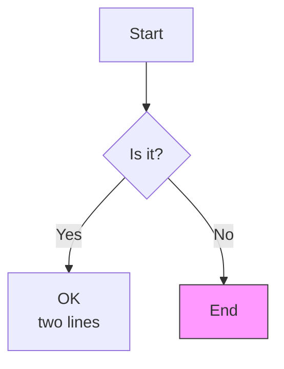
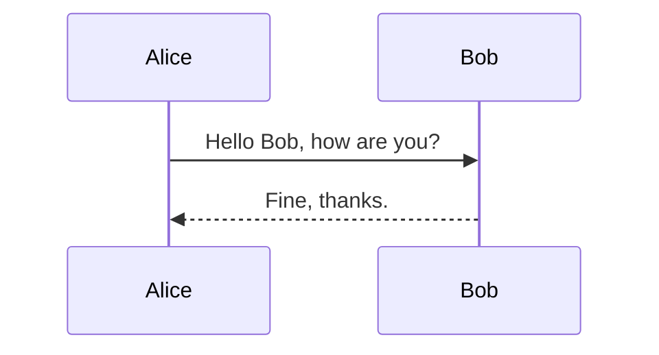
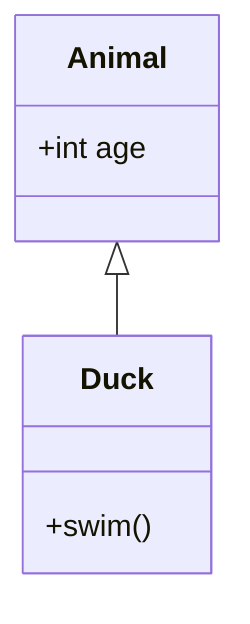
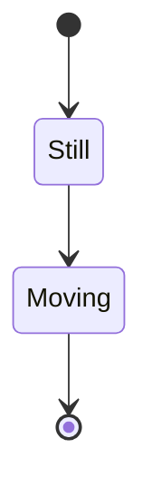
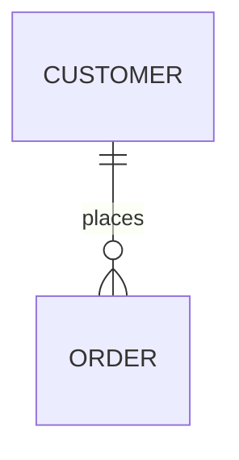
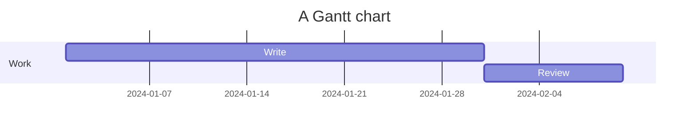
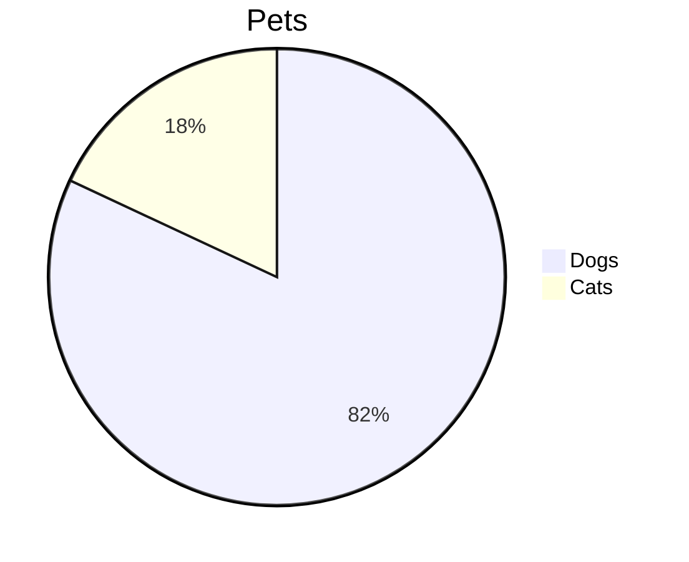
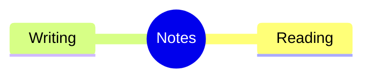
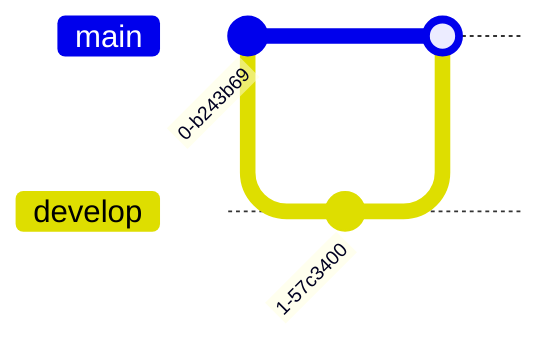
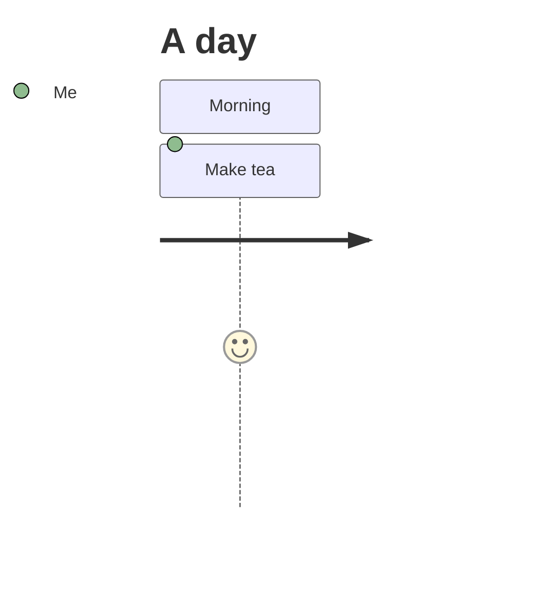

# Drawn blocks

[TOC]

## Mermaid diagrams

A flowchart, with a line break in a label and a styled node:



A sequence diagram:



A class diagram:



A state diagram:



An entity relationship diagram:



A Gantt chart:



A pie chart:



A mind map:



A git graph:



A user journey:



One with a mistake, which shows a message in its place:

```mermaid
graph TD;
  A-->
```

## Embedded notes

A whole note, a section and a block, each on a line of its own:

![[Other note]]

![[Other note#Part two]]

![[Other note#^quote-1]]

An embed of a note that is not there:

![[Missing]]

## Block ids

A paragraph with an id at its end. ^para-1

- one
- two ^item-2

## Git's conflict markers

A conflict git left after a merge:

<<<<<<< HEAD
Budget: 4,200, agreed with Dana on the 12th.
=======
Budget: 4,500.
>>>>>>> north-wall

With the lines as they were before either change, as git writes them when set to:

<<<<<<< HEAD
- Paint the north wall.
||||||| 1a2b3c4
- Paint the walls.
=======
- Paint the walls blue.
>>>>>>> north-wall
